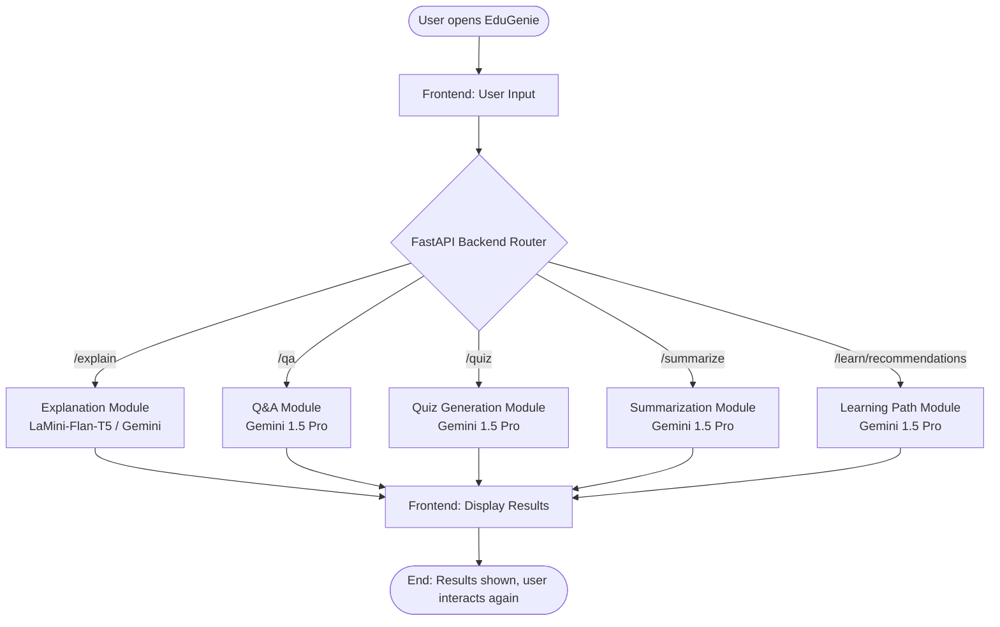

# EduGenie: Google Gemini Powered Learning Assistant

EduGenie is a lightweight AI-powered educational assistant that simplifies learning through generative AI. Designed for students of all academic levels, EduGenie enables users to ask questions, understand complex topics with simplified explanations, generate quizzes, summarize long educational passages, and receive personalized learning recommendations.

Built with **FastAPI** on the backend and a responsive **HTML + CSS** frontend, EduGenie leverages both lightweight local models and cloud-based Google Gemini AI.

---

## 🏛️ Project Details

- **Institution**: St. Thomas College of Arts and Science  
  *Affiliated to the University of Madras | 2(f) Status Under UGC Act | NAAC 'A+' Grade | Koyambedu, Chennai - 600 107*
- **Department**: Department of Computer Science (Shift-II)
- **Initiative**: Tn Skills Project – Generative AI

### 👥 Team Members

| Sl. No | Name | NM ID |
|:---:|:---|:---|
| 1 | Aaron A | `288F901534B0B6BBCB74CD3C988F765D` |
| 2 | Praveen Kumar K | `34B6DE9336E06CC9DA8433143A50ECE9` |
| 3 | Selva Kumar | `821A6EEEA4A71FDBAD04CAAA6C0B13E7` |
| 4 | Dinesh Kumar | `9B689B2BF20EEC28D4441ABC1C08AD93` |
| 5 | Vinoth S | `F6F89D3B2E3D572BA37424CF5769A5CF` |

- **Submitted by**: Tella Divya Sree
- **Mentor**: Siri

---

## 🏗️ Architectural Flow



---

## 📂 Project Architecture

```
EduGenie/
├── main.py                  # FastAPI server & route handlers
├── explanation_module.py    # Concept explanation logic (LaMini-Flan-T5-783M)
├── qna.py                   # Question answering with Gemini 1.5 Pro
├── quiz_module.py           # 3 MCQ JSON quiz generation logic
├── summary_module.py        # Text summarization logic
├── learning_path.py         # Structured learning roadmaps & recommendations
├── templates/
│   └── index.html           # HTML UI frontend
├── static/
│   └── style.css            # Responsive CSS styling
├── requirements.txt         # Python dependencies
├── .env.example             # Environment template
└── .env                     # API key configuration
```

---

## 🚀 Getting Started

### 1. Prerequisites
- Python 3.10+
- Google Gemini API Key ([Get one from Google AI Studio](https://aistudio.google.com/))

### 2. Setup Virtual Environment & Install Dependencies
```bash
python -m venv venv
# On Windows:
.\venv\Scripts\activate
# On macOS / Linux:
source venv/bin/activate

pip install -r requirements.txt
```

### 3. Configure Gemini API Key
Create a `.env` file in the project root:
```env
GEMINI_API_KEY=your_gemini_api_key_here
```

### 4. Run the Application
```bash
uvicorn main:app --reload
```

The application will be accessible at `http://127.0.0.1:8000`.

---

## 🔌 API Endpoints

| Method | Endpoint | Description | Payload / Query |
|:---|:---|:---|:---|
| `GET` | `/` | Web UI Dashboard | HTML Page |
| `GET` | `/qa?question=...` | Smart question answering | `question` (string) |
| `POST` | `/explain` | Concept simplification | `{"topic": "Photosynthesis"}` |
| `POST` | `/summarize` | Paragraph summarization | `{"text": "..."}` |
| `POST` | `/quiz` | 3 Multiple-Choice Quiz | `{"text": "Solar System"}` |
| `GET` | `/learn/recommendations?topic=...` | Personalized Learning Path | `topic` (string) |

---

## 🧪 Testing & Verification

1. **Q&A**: Ask *"Which is the largest ocean?"* ➡️ Returns concise, accurate answer.
2. **Explanation**: Enter *"Quantum Computing"* or *"Binary Search Algorithm"* ➡️ Returns a student-friendly explanation.
3. **Summarization**: Paste a long historical or scientific paragraph ➡️ Returns key takeaways.
4. **Quiz Generation**: Enter *"Pythagoras theorem"* ➡️ Generates 3 MCQs with interactive answer checking.
5. **Learning Path**: Enter *"SQL"* ➡️ Produces a progressive roadmap with beginner, intermediate, and advanced levels with resources.
